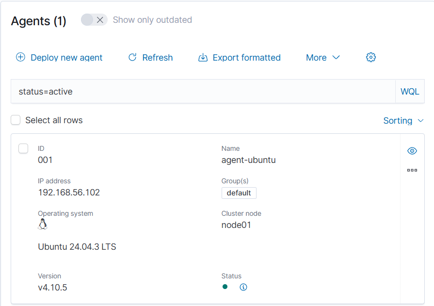

# Lab setup

## Environment

- Host: Windows PC with VirtualBox
- I administer both VMs over SSH from PowerShell (the VirtualBox console has no
  copy-paste).

| VM           | OS                               | Resources                    | Network         | Address        |
| ------------ | -------------------------------- | ---------------------------- | --------------- | -------------- |
| Wazuh-Server | Ubuntu Server 22.04              | 8 GB RAM, 4 vCPU, 50 GB disk | NAT + Host-only | 192.168.56.101 |
| agent-ubuntu | Ubuntu (clone of my everyday VM) | 2 GB RAM, 2 vCPU             | Host-only       | 192.168.56.102 |

The host-only network (192.168.56.0/24) is how the PC and the VMs talk to each other.

## Wazuh components (all-in-one install, version 4.10.5)

- **Agent:** runs on the monitored machine, collects logs and sends them to the manager.
- **Manager:** decodes each event and matches it against rules. A match produces an alert.
- **Indexer:** stores the alerts so they can be searched.
- **Dashboard:** web interface to browse and search the alerts.

The manager machine also monitors itself as agent `000`.

## Agent enrollment

agent-ubuntu was enrolled with the manager and shows as Active in the dashboard.

## Snapshots

- `wazuh-installe-ok` (Wazuh-Server)
- `agent-enrolle-ok` (agent-ubuntu)

## Caveat: the agent is a full clone

agent-ubuntu is a full clone of my everyday VM, so it inherited settings that do not
fit the lab, such as a shared-folder mount in `/etc/fstab`. See
[02 Troubleshooting](02-troubleshooting.md).
