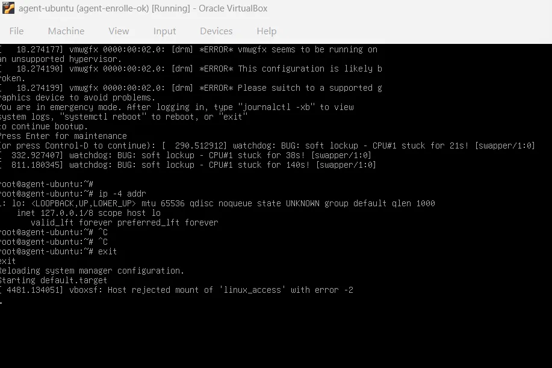

# Troubleshooting

## 1. `curl` printed the installer instead of saving it

**Cause:** wrong option. **Fix:** `curl -fsSLO <url>` saves the file.

## 2. Installer failed while downloading wazuh-dashboard

**Symptom:** network read error during the download. `wazuh-manager` stayed
half-installed (dpkg state `ic`).

**Problem:** the package's `postrm` script also failed, so the package could not
be removed normally.

**Fix:** moved the failing `postrm` script aside, then ran
`dpkg --purge --force-all`, and reran the installer.

**Note:** `--force-all` is a last resort and can leave the system inconsistent.
Next time I would try `apt --fix-broken install` first.

## 3. No copy-paste in the VM console

**Fix:** use SSH from PowerShell (right-click pastes into the terminal).

## 4. SSH username confusion

**Symptom:** `Permission denied` although the password was correct.

**Cause:** I typed the hostname before the `@` instead of the username.
SSH needs `ssh USERNAME@ADDRESS` (for example `ssh wazuh@192.168.56.101`).

## 5. Agent unreachable over SSH (boot into emergency mode)

**Symptom:** `ssh azza@192.168.56.102` timed out. The VirtualBox console showed
emergency mode, and `ip -4 addr` listed only the loopback interface.

**Diagnosis**

- Console message: `vboxsf: Host rejected mount of 'linux_access' with error -2`
- `systemctl --failed` listed `mnt-shared.mount` (`/mnt/shared`)
- `/etc/fstab` line 11: `linux_access /mnt/shared vboxsf defaults 0 0`

**Cause:** the clone inherited a VirtualBox shared-folder entry from the original VM.
The share does not exist for the clone, so the mount fails. The entry has no
`nofail`, so the failure interrupts the boot.

**Fix applied:** exited emergency mode from the console. The VM finished booting,
the network came up and the agent worked again.

**Known issue (not fixed yet):** the fstab entry is still present, so a reboot will
probably cause the same problem. Planned fix: back up `/etc/fstab`, comment out
line 11, run `sudo systemctl daemon-reload`, reboot and check `systemctl --failed`.

**Lesson:** a full clone inherits host-specific settings (shared folders, fstab
entries). Check them before using a clone as a lab machine.
