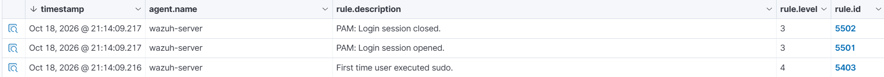
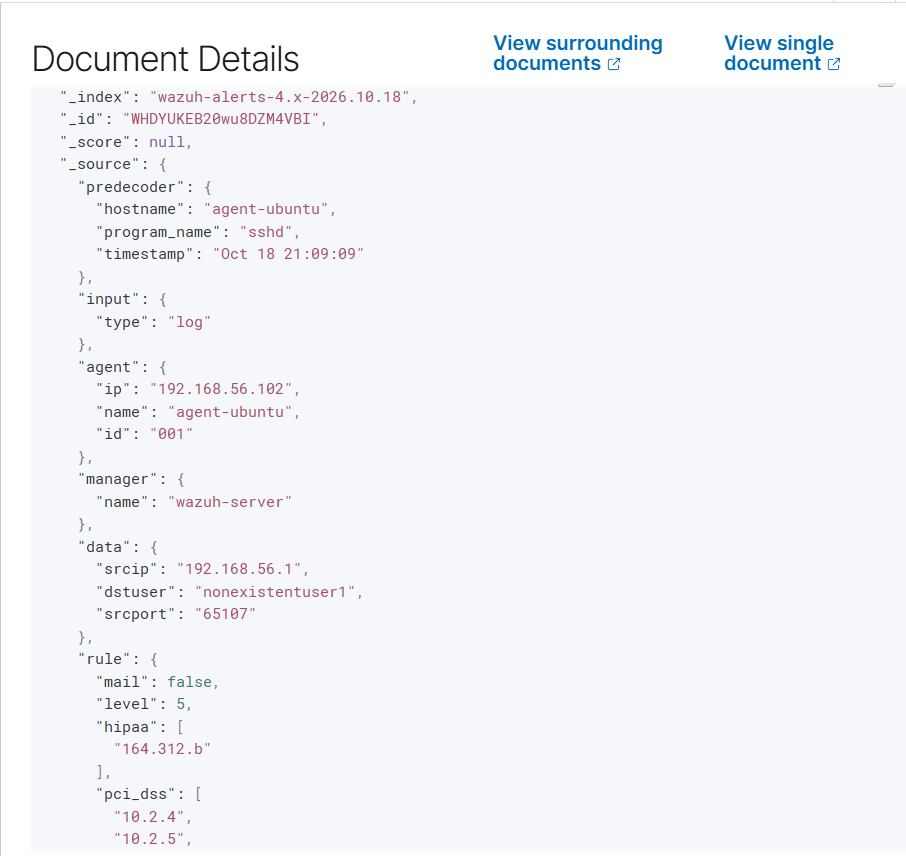

# First alerts

Goal: generate two harmless events and trace each one from the raw log line to the
Wazuh alert.

Times in the alert JSON are UTC. My dashboard shows local time (UTC+1), one hour
later.

## Alert 1: sudo on the Wazuh server (baseline)

**What I did:** ran a command with `sudo` on `wazuh-server`.



Raw log line (rule 5502):

```
Oct 18 20:14:07 wazuh-server sudo[3560]: pam_unix(sudo:session): session closed for user root
```

| Field      | Value                                                                                                         |
| ---------- | ------------------------------------------------------------------------------------------------------------- |
| agent      | wazuh-server (id 000)                                                                                         |
| location   | journald                                                                                                      |
| decoder    | pam                                                                                                           |
| rules seen | 5403 (level 4, first time user executed sudo), 5501 (level 3, session opened), 5502 (level 3, session closed) |
| ATT&CK     | none on 5502                                                                                                  |

**Interpretation:** normal activity. The description says "Login session closed",
but the line is the end of a `sudo` session, not a user logging out. I read
`full_log` before trusting a description.

## Alert 2: SSH login with a non-existent user (rule 5710)

**What I did:** from my Windows host (192.168.56.1) I ran
`ssh nonexistentuser1@192.168.56.102` and did not complete a login.


(../images/ssh-5710-json-2.png)
Raw log line:

```
Oct 18 21:09:09 agent-ubuntu sshd[3042]: Connection reset by invalid user nonexistentuser1 192.168.56.1 port 65107 [preauth]
```

| Field                | Value                                                             |
| -------------------- | ----------------------------------------------------------------- |
| agent                | agent-ubuntu (id 001, 192.168.56.102)                             |
| rule                 | 5710, level 5, "sshd: Attempt to login using a non-existent user" |
| groups               | syslog, sshd, authentication_failed, invalid_login                |
| data.srcip / srcport | 192.168.56.1 / 65107                                              |
| data.dstuser         | nonexistentuser1                                                  |
| location             | journald                                                          |
| ATT&CK               | T1110.001 Password Guessing, T1021.004 SSH                        |

**What the rule matches:** rule 5710 is in
`/var/ossec/ruleset/rules/0095-sshd_rules.xml`. It has `if_sid` 5700 and matches the
text `illegal user|invalid user`. Rule 5700 is a parent rule (level 0, `noalert`)
that matches any event decoded as `sshd` and only groups sshd messages. My log line
was decoded as sshd (5700) and contains "invalid user", so 5710 fired.

**Interpretation:** a host on the lab network tried to log in over SSH with a user
that does not exist. The source IP was extracted correctly, so alerts can be
filtered by source. The connection was reset before authentication finished
(`[preauth]`), so this shows an invalid-user attempt, not a failed password.

## Observations

1. Both alerts came from `journald`, not from a log file such as `/var/log/auth.log`.
2. Rule 5710 fires on a single line and has no `frequency` or `timeframe`. It does
   not count attempts, so it is not a brute-force detection by itself.
3. The ATT&CK tag describes a technique the activity might belong to. One attempt
   with a non-existent user is a weak signal.
4. Rule 5501 (PAM session opened) carries T1078 Valid Accounts, but it also fires on
   my own normal logins, so the tag alone does not make it a useful detection.
5. Rule 5502 has compliance tags but no ATT&CK mapping.

Next: a frequency-based rule for repeated SSH attempts (Phase 3).
